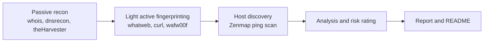
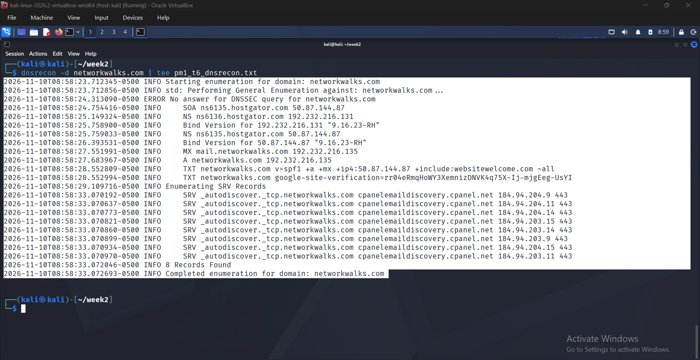

# Footprinting, OSINT & Network Scanning Lab


| | |
|---|---|
| **Author** | [BHARGAV] |
| **Program** | Cybersecurity & Ethical Hacking Internship, Networkwalks |
| **Modules** | W2-PM1, W2-PM4, W2-PM5 and W2-PM-FINAL |
| **Date** | 10 November 2026 |
| **Status** | Completed |

---

## Table of Contents

1. [Executive Summary](#1-executive-summary)
2. [Scope and Authorization](#2-scope-and-authorization)
3. [Lab Environment](#3-lab-environment)
4. [Methodology](#4-methodology)
5. [Module W2-PM1: Footprinting with Kali Tools](#5-module-w2-pm1-footprinting-with-kali-tools)
6. [Module W2-PM4: OSINT with theHarvester](#6-module-w2-pm4-osint-with-theharvester)
7. [Module W2-PM5: Network Scanning with Zenmap](#7-module-w2-pm5-network-scanning-with-zenmap)
8. [Findings and Risk Summary](#8-findings-and-risk-summary)
9. [Recommendations](#9-recommendations)
10. [Limitations](#10-limitations)
11. [Key Learnings](#11-key-learnings)
12. [Repository Structure](#12-repository-structure)
13. [Glossary](#13-glossary)
14. [References](#14-references)
15. [Disclaimer](#15-disclaimer)

---

## 1. Executive Summary

This project covers the first two phases of a security assessment: **reconnaissance** and **scanning**. Using only built-in Kali Linux tools, I gathered public information about a web domain, collected emails and sub-domains for a large organization from open sources, and mapped the live hosts on my own lab network.

**Highlights**

- Built a technical profile of `networkwalks.com`: registrar, hosting provider, web stack, WAF, and DNS and mail setup.
- Collected 3 email addresses and 8809 hosts for `microsoft.com` from public sources with theHarvester.
- Discovered 2 live hosts on the lab subnet `10.0.0.0/24` and saved the network topology as a PDF.
- Identified 10 information-exposure observations, rated Low or Medium. No exploitation was performed.

## 2. Scope and Authorization

| Target | Method | Authorization |
|---|---|---|
| `networkwalks.com` | whois, whatweb, nslookup, curl, wafw00f, dnsrecon | Permission secured through the Networkwalks program |
| `microsoft.com` | theHarvester against public data sources | Public sources only, as assigned in the lab task |
| `10.0.0.0/24` | Zenmap ping scan | My own VirtualBox lab network |

**Out of scope:** exploitation, vulnerability validation, password attacks, port and service scanning, and any system not listed above.

> whois, nslookup, dnsrecon and theHarvester read public records and public data sources. whatweb, curl and wafw00f send a small number of normal HTTP requests to the target, so they are lightly active.

## 3. Lab Environment

| Item | Value |
|---|---|
| Hypervisor | Oracle VirtualBox |
| Operating system | Kali Linux 2026.2 (amd64) |
| Network interface | `eth0`, `10.0.0.2/24` |
| MAC address | `08:00:27:5a:87:bc` |

| Tool | Version | Purpose |
|---|---|---|
| whois | Kali default | Domain registration data |
| whatweb | Kali default | Web technology fingerprinting |
| nslookup | Kali default | DNS name to IP resolution |
| curl | Kali default | HTTP response headers |
| wafw00f | 2.4.2 | Web application firewall detection |
| dnsrecon | Kali default | DNS record enumeration |
| theHarvester | 4.10.1 | Email and sub-domain OSINT |
| Zenmap / Nmap | 7.99 | Host discovery and topology |

## 4. Methodology

1. **Passive information gathering:** registration data, DNS records and open sources.
2. **Light active fingerprinting:** HTTP headers, web technologies and WAF detection.
3. **Host discovery:** ping scan of the local subnet.
4. **Documentation:** every command output was saved with `| tee <file>.txt` and screenshotted.
5. **Analysis:** findings were rated Low, Medium or Critical by likely impact.



### Quick Reproduction Guide

Run these in Kali Linux, only against targets you are authorized to test. Replace the lab domain and subnet with your own.

```bash
mkdir ~/week2 && cd ~/week2

# W2-PM1: footprinting
whois networkwalks.com | tee pm1_t1_whois.txt
whatweb networkwalks.com | tee pm1_t2_whatweb.txt
nslookup networkwalks.com | tee pm1_t3_nslookup.txt
curl -I https://networkwalks.com | tee pm1_t4_curl.txt
wafw00f networkwalks.com | tee pm1_t5_wafw00f.txt
dnsrecon -d networkwalks.com | tee pm1_t6_dnsrecon.txt

# W2-PM4: OSINT
theHarvester -d microsoft.com -l 1000 -b baidu | tee pm4_t1_baidu.txt
theHarvester -d microsoft.com -l 50 -b all 2>&1 | tee pm4_t2_all.txt

# W2-PM5: network scanning (GUI: Zenmap, Ping scan profile)
ip a
sudo zenmap          # target 10.0.0.0/24, profile "Ping scan"
```

### Evidence Index

| File | Module | Shows |
|---|---|---|
| `pm1-01-whois.png` to `pm1-06-dnsrecon.png` | PM1 | Output of the six footprinting tools |
| `pm4-01-help.png` | PM4 | theHarvester usage and options |
| `pm4-02-baidu.png` | PM4 | Baidu source run (no results) |
| `pm4-03-all-sources-start.png` | PM4 | All-sources run and missing API key messages |
| `pm4-04-all-sources-results.png` | PM4 | IPs, 3 emails and 8809 hosts found |
| `pm5-01-ip-a.png` | PM5 | VM IP, subnet and MAC |
| `pm5-02-zenmap-ping-scan.png` | PM5 | Ping scan with 2 hosts up |
| `pm5-03-topology.png`, `pm5-04-topology-pdf.png` | PM5 | Topology view and saved PDF |

---

## 5. Module W2-PM1: Footprinting with Kali Tools

**Target:** `networkwalks.com`

| Task | Command | Key result |
|---|---|---|
| 1. Domain registration | `whois networkwalks.com` | Registrar GoDaddy.com, LLC. Created 2019-11-06, expires 2027-11-06. Name servers `NS6135.HOSTGATOR.COM` and `NS6136.HOSTGATOR.COM`. DNSSEC unsigned. Registrar locks set. |
| 2. Web technologies | `whatweb networkwalks.com` | Apache, WordPress 7.1.4, WP Download Manager 3.3.76, jQuery 3.7.1. Server IP and a contact email exposed. |
| 3. IP resolution | `nslookup networkwalks.com` | Resolved to `192.232.216.135` via DNS server `8.8.8.8`. |
| 4. HTTP headers | `curl -I https://networkwalks.com` | HTTP/2 200, `server: Apache`, cache headers, WordPress REST API link at `/wp-json/`. |
| 5. WAF detection | `wafw00f networkwalks.com` | ModSecurity (SpiderLabs) WAF detected. 2 requests sent. |
| 6. DNS enumeration | `dnsrecon -d networkwalks.com` | HostGator name servers running BIND 9.16.23-RH, MX `mail.networkwalks.com`, SPF ending in `~all`, 8 cPanel SRV records. |

<details>
<summary><b>Evidence: PM1 screenshots</b></summary>

**Task 1: whois**


**Task 2: whatweb**


**Task 3: nslookup**


**Task 4: curl -I**


**Task 5: wafw00f**


**Task 6: dnsrecon**


</details>

## 6. Module W2-PM4: OSINT with theHarvester

**Target:** `microsoft.com` (public sources only)

| Run | Command | Result |
|---|---|---|
| Task 1: Baidu, limit 1000 | `theHarvester -d microsoft.com -l 1000 -b baidu` | No IPs, emails, people or hosts found |
| Task 2: all sources, limit 50 | `theHarvester -d microsoft.com -l 50 -b all` | 3 emails and 8809 hosts found; no people found |

Options used: `-d` target domain, `-l` result limit, `-b` data source.

**Notes**

- Different sources returned very different results, so more than one source should always be tried.
- Sources that need an API key (for example bevigil, Bitbucket, BuiltWith, Brave and Censys) failed with "Missing API key". Real exposure may be larger than what was collected.
- The all-sources run returned more than the limit of 50 because some sources do not apply the limit.

<details>
<summary><b>Evidence: PM4 screenshots</b></summary>

**Help page and options**


**Task 1: Baidu**


**Task 2: all sources, start of run**


**Task 2: all sources, results**


</details>

## 7. Module W2-PM5: Network Scanning with Zenmap

**Target:** own VirtualBox lab network `10.0.0.0/24`

**Command:** `nmap -sn 10.0.0.0/24` (Zenmap profile: Ping scan). The scan covered 256 addresses in 3.02 seconds.

| Question | Answer |
|---|---|
| Local IP address and subnet | `10.0.0.2` on `10.0.0.0/24` |
| Live hosts | 2 (including my own VM) |
| IP addresses | `10.0.0.1`, `10.0.0.2` |
| MAC addresses | `10.0.0.1`: `52:54:00:12:35:00` (QEMU virtual NIC). `10.0.0.2`: `08:00:27:5a:87:bc` (my VM, taken from `ip a`, because a host does not list its own MAC in its scan) |

`10.0.0.1` is most likely the virtual gateway of the VirtualBox network. In the topology, the local host sits in the centre and both hosts show as green nodes (fewer than three open ports; no port scan was run).

<details>
<summary><b>Evidence: PM5 screenshots</b></summary>

**Local IP, subnet and MAC (`ip a`)**


**Zenmap ping scan**


**Topology tab**


**Topology saved as PDF**


</details>

---

## 8. Findings and Risk Summary

These are observations from information gathering. They are **not** confirmed vulnerabilities; further authorized testing would be needed to confirm any of them.

| # | Finding | Evidence | Risk |
|---|---|---|---|
| 1 | Web software and versions exposed | WordPress 7.1.4 and WP Download Manager 3.3.76 (whatweb) | Medium |
| 2 | DNS software version disclosed | BIND 9.16.23-RH on both name servers (dnsrecon) | Medium |
| 3 | Very large sub-domain footprint | 8809 hosts for `microsoft.com` (theHarvester) | Medium |
| 4 | Server IP and hosting provider identifiable | `192.232.216.135`, HostGator name servers | Low |
| 5 | HTTP technical details exposed | Cache headers and `/wp-json/` link (curl) | Low |
| 6 | WAF technology identifiable | ModSecurity (SpiderLabs) (wafw00f) | Low |
| 7 | DNSSEC not enabled | whois "unsigned", no DNSSEC answer (dnsrecon) | Low |
| 8 | SPF uses soft fail | Record ends in `~all` (dnsrecon) | Low |
| 9 | Public email addresses | 1 on `networkwalks.com`, 3 on `microsoft.com` | Low |
| 10 | Live hosts visible on lab network | 2 hosts on `10.0.0.0/24` (Zenmap) | Low |

## 9. Recommendations

1. **Limit exposed technology details:** hide or reduce version information and unneeded headers such as the `/wp-json/` link where it is not required.
2. **Keep software updated:** WordPress, plugins and DNS software (such as BIND) should be patched and checked against current advisories.
3. **Harden DNS and email:** consider enabling DNSSEC and move SPF from `~all` to `-all` once all legitimate mail sources are listed.
4. **Maintain the WAF:** keep ModSecurity enabled and tuned.
5. **Reduce exposed emails and sub-domains:** use role-based addresses with spam filtering, remove forgotten sub-domains and keep an inventory of public hosts.
6. **Scan your own network regularly:** investigate any unknown device and keep topology documentation current.
7. **Test only with authorization:** always work inside a written, agreed scope.

## 10. Limitations

- No port scan, service detection or vulnerability scan was run, so no vulnerabilities are confirmed.
- theHarvester sources needing API keys did not run, so its results are incomplete.
- Results depend on the time of the scan and on third-party sources, which change over time.
- The Zenmap scan covers a small virtual lab network, not a production environment.

## 11. Key Learnings

- Public information alone can reveal an organization's hosting, software stack, DNS and email setup.
- Using several data sources gives a fuller picture than any single one.
- Host discovery is a fast way to see what is on a network and to spot unknown devices.
- A good report states what was done, what was found, what it means and how to reduce the risk.
- Reconnaissance and scanning must always stay inside an authorized scope.

### Skills Demonstrated

| Area | Skill |
|---|---|
| Reconnaissance | Domain, DNS and web-stack footprinting; OSINT collection |
| Tooling | Kali Linux CLI tools, Zenmap/Nmap GUI, output logging with `tee` |
| Analysis | Turning raw tool output into rated findings and recommendations |
| Documentation | Evidence capture, reporting and a reproducible write-up |
| Professionalism | Scope control, authorization and responsible reporting |

## 12. Repository Structure

```
.
├── README.md
└── screenshots/
    ├── pm1-01-whois.png ... pm1-06-dnsrecon.png
    ├── pm4-01-help.png ... pm4-04-all-sources-results.png
    └── pm5-01-ip-a.png ... pm5-04-topology-pdf.png
```

## 13. Glossary

| Term | Meaning |
|---|---|
| Reconnaissance / footprinting | Collecting information about a target before testing it |
| OSINT | Open-source intelligence, information from public sources |
| WAF | Web application firewall that filters malicious web traffic |
| DNSSEC | DNS security extension that digitally signs DNS answers |
| SPF | DNS record listing which servers may send email for a domain |
| MX / SRV record | DNS records for mail servers / for specific services |
| Ping scan | Host discovery that finds live hosts without scanning ports |
| Topology | A diagram of how discovered hosts connect |

## 14. References

- Nmap and Zenmap documentation: https://nmap.org
- Kali Linux tools: https://www.kali.org/tools/
- theHarvester: https://github.com/laramies/theHarvester
- wafw00f: https://github.com/EnableSecurity/wafw00f
- WhatWeb: https://github.com/urbanadventurer/WhatWeb
- dnsrecon: https://github.com/darkoperator/dnsrecon
- Networkwalks: https://networkwalks.com

## 15. Disclaimer

This repository is for education and research only. Every activity was performed on a target I had permission to test, through public sources only, or on my own lab network. Unauthorized access to systems is illegal in most countries even when nothing is damaged. Do not use anything here against systems you do not own or have written permission to test. The author and Networkwalks are not responsible for misuse.

---

**Author:** [BHARGAV], Cybersecurity Intern, Networkwalks (B084D)
**Contact:** [LinkedIn profile link]  |  [GitHub profile link]
`#Networkwalks #Cybersecurity #EthicalHacking`
