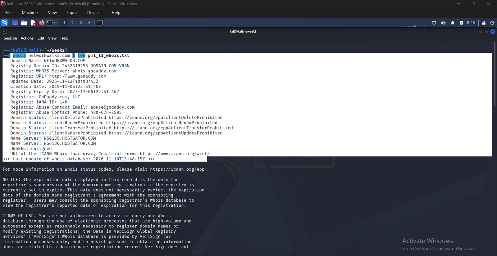
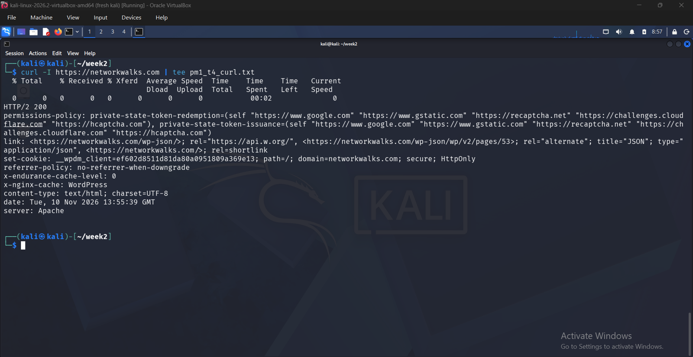
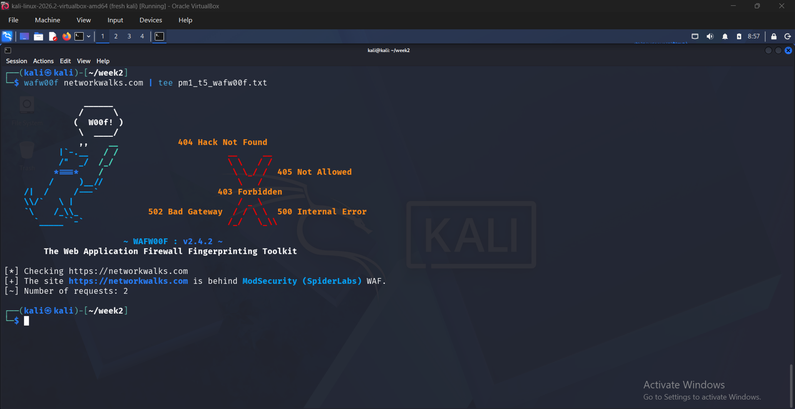
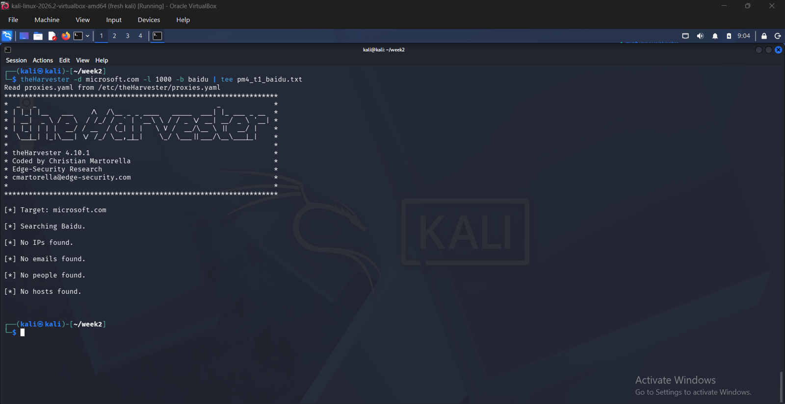
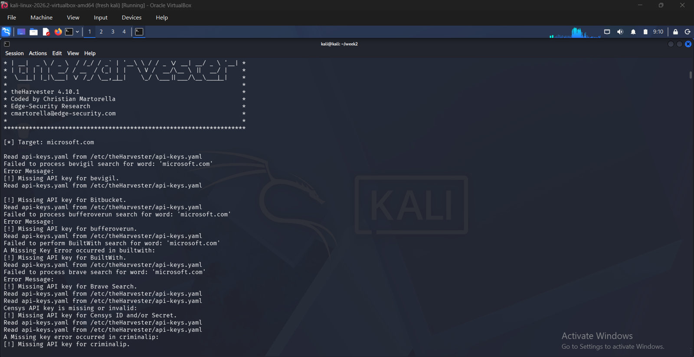
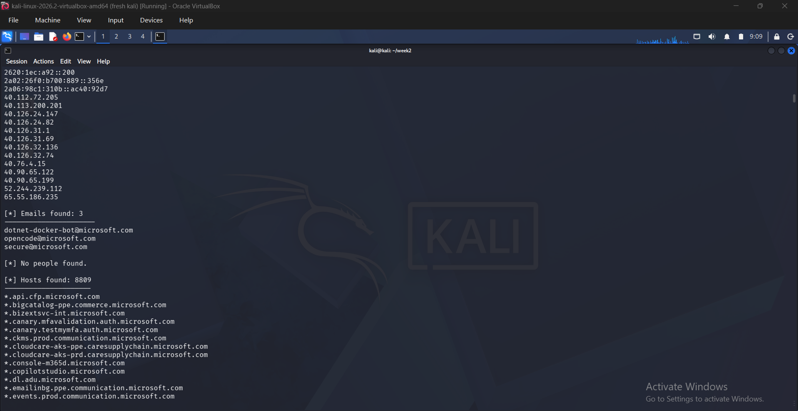
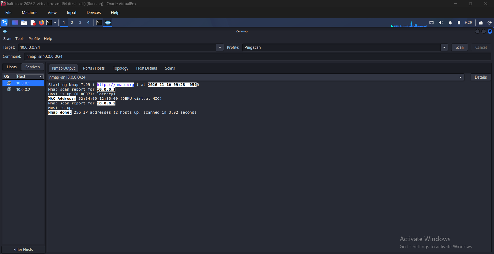
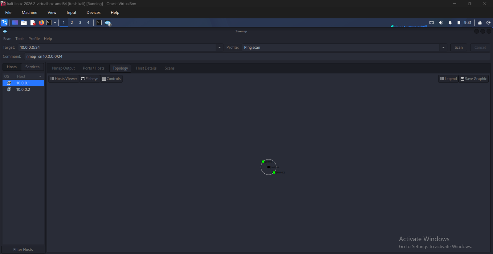
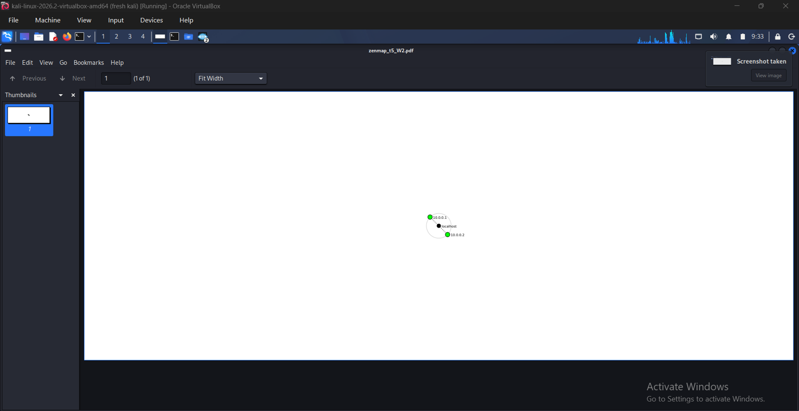

# Week 2: Footprinting, OSINT & Network Scanning Lab

**Program:** Cybersecurity & Ethical Hacking Internship, Networkwalks
**Batch:** B084D
**Week / Modules:** Week 2, W2-PM1, W2-PM4, W2-PM5 and W2-PM-FINAL
**Author:** [Your Name]
**Date:** 10 November 2026

> **Disclaimer:** This repository is for education and research only. Every activity was done on a target I had permission to test (the Networkwalks lab domain), through public sources only (microsoft.com OSINT), or on my own lab network. Do not use anything here against systems you do not own or have written permission to test.

---

## Overview

This lab covers the first two phases of a security test:

1. **Reconnaissance and footprinting:** collecting public information about a target without attacking it (PM1 and PM4).
2. **Scanning and network discovery:** finding live hosts on a network (PM5).

All work was done in **Kali Linux 2026.2** running in **Oracle VirtualBox**.

## Lab Environment

| Item | Value |
|---|---|
| Hypervisor | Oracle VirtualBox |
| Operating system | Kali Linux 2026.2 (amd64) |
| Kali VM interface | eth0, 10.0.0.2/24 |
| Kali VM MAC | 08:00:27:5a:87:bc |
| Tools | whois, whatweb, nslookup, curl, wafw00f 2.4.2, dnsrecon, theHarvester 4.10.1, Zenmap / Nmap 7.99 |

---

## Module W2-PM1: Footprinting with Multiple Kali Tools

**Target:** `networkwalks.com` (permission secured)

Each command was saved to a text file with `| tee filename.txt`.

### Task 1: whois (domain registration)

```bash
whois networkwalks.com | tee pm1_t1_whois.txt
```

**Result:** Registrar GoDaddy.com, LLC. Created 2019-11-06, expires 2027-11-06. Name servers `NS6135.HOSTGATOR.COM` and `NS6136.HOSTGATOR.COM`. DNSSEC unsigned. Registrar locks are set.



### Task 2: whatweb (web technologies)

```bash
whatweb networkwalks.com | tee pm1_t2_whatweb.txt
```

**Result:** Apache, WordPress 7.1.4, WP Download Manager 3.3.76, jQuery 3.7.1, Google Tag Manager. Server IP and a contact email are exposed.


### Task 3: nslookup (IP address)

```bash
nslookup networkwalks.com | tee pm1_t3_nslookup.txt
```

**Result:** Resolved to `192.232.216.135` using DNS server 8.8.8.8.


### Task 4: curl -I (HTTP headers)

```bash
curl -I https://networkwalks.com | tee pm1_t4_curl.txt
```

**Result:** HTTP/2 200, `server: Apache`, cache headers, and a `link` header showing the WordPress REST API at `/wp-json/`.



### Task 5: wafw00f (web application firewall)

```bash
wafw00f networkwalks.com | tee pm1_t5_wafw00f.txt
```

**Result:** The site is behind **ModSecurity (SpiderLabs)** WAF. Number of requests: 2.



### Task 6: dnsrecon (DNS records)

```bash
dnsrecon -d networkwalks.com | tee pm1_t6_dnsrecon.txt
```

**Result:** SOA and NS on HostGator with BIND 9.16.23-RH, MX `mail.networkwalks.com`, SPF record ending in `~all`, 8 cPanel autodiscover SRV records.


---

## Module W2-PM4: Footprinting with theHarvester

**Target:** `microsoft.com` (public sources only, no direct attack)

Help page and options:

```bash
theHarvester -h
```


### Task 1: Baidu source, limit 1000

```bash
theHarvester -d microsoft.com -l 1000 -b baidu | tee pm4_t1_baidu.txt
```

**Result:** No IPs, emails, people or hosts found from Baidu.



### Task 2: All sources, limit 50

```bash
theHarvester -d microsoft.com -l 50 -b all 2>&1 | tee pm4_t2_all.txt
```

**Result:** 3 emails and 8809 hosts found. Several sources failed with "Missing API key" because no keys were configured.





---

## Module W2-PM5: Network Scanning with Zenmap

**Target:** my own VirtualBox lab network

### Find IP address and subnet

```bash
ip a
```

IP `10.0.0.2/24`, so the subnet is `10.0.0.0/24`.


### Ping scan in Zenmap

Target `10.0.0.0/24`, profile **Ping scan** (`nmap -sn 10.0.0.0/24`).



| Question | Answer |
|---|---|
| How many hosts are live? | 2 |
| IP addresses | 10.0.0.1, 10.0.0.2 |
| MAC addresses | 10.0.0.1: 52:54:00:12:35:00 (QEMU virtual NIC), 10.0.0.2: 08:00:27:5a:87:bc (my VM, from `ip a`) |

### Topology

Topology tab, Legend on, **Save Graphic** as PDF.





---

## Key Findings

| # | Finding | Level |
|---|---|---|
| 1 | WordPress and plugin versions are visible | Medium |
| 2 | DNS software version (BIND) is disclosed | Medium |
| 3 | Very large sub-domain list for microsoft.com (8809 hosts) | Medium |
| 4 | Server IP, hosting provider and WAF type are identifiable | Low |
| 5 | Exposed HTTP headers and `/wp-json/` endpoint | Low |
| 6 | DNSSEC not enabled, SPF uses soft fail (`~all`) | Low |
| 7 | Public email addresses can be used for phishing | Low |

These are observations from information gathering, not confirmed vulnerabilities. No exploitation was performed.

## What I Learned

- Recon tools show how much public information an organization leaks.
- Different data sources give different results, so use more than one.
- Some tools need API keys to return full results.
- Host discovery is a quick way to see what is on a network and to spot unknown devices.
- Always work inside an authorized scope.

## Repository Structure

```
.
├── README.md
├── screenshots/     # evidence for every task
└── report/
    └── W2-PM-FINAL_Penetration_Testing_Report.docx
```

## Full Report

The complete penetration testing report is in [`report/`](report/).

## Author

**[Your Name]**, Cybersecurity intern, Networkwalks (B084D)

`#Networkwalks #Cybersecurity #EthicalHacking`
