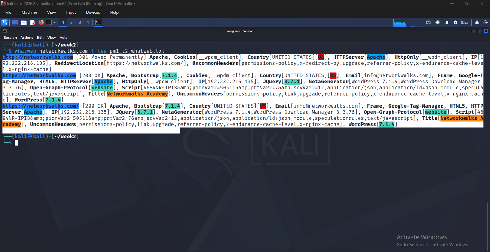
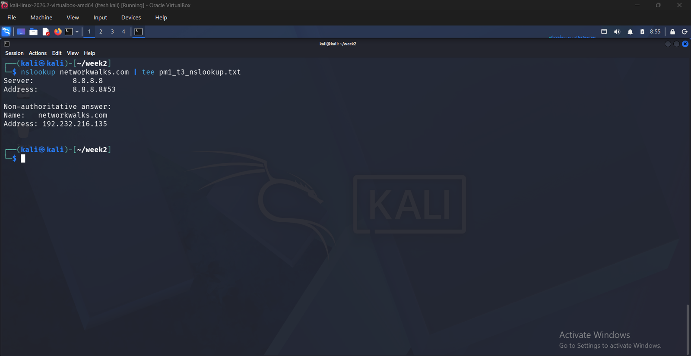
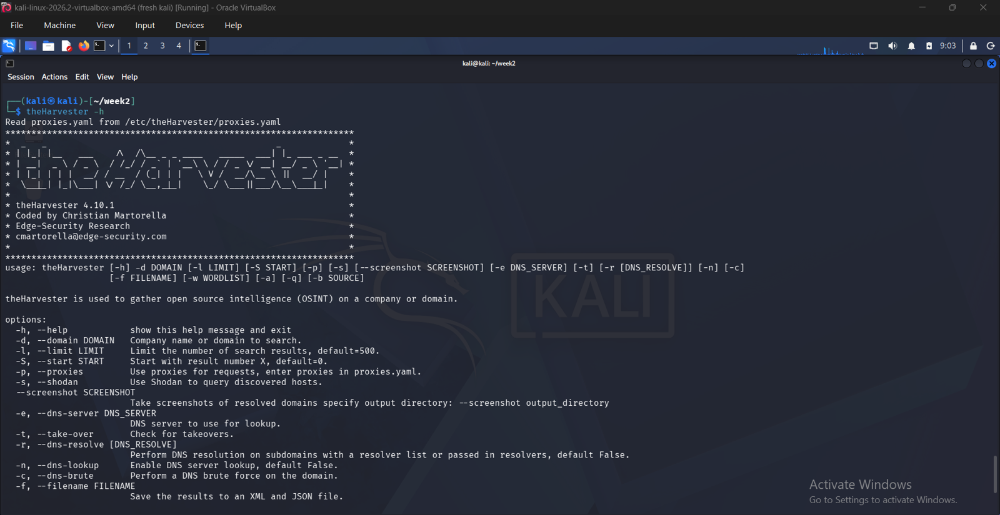
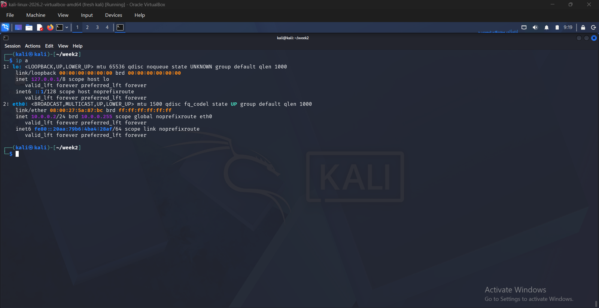

<div align="center">

# Footprinting, OSINT & Network Scanning Lab

**Networkwalks Cybersecurity & Ethical Hacking Internship | Week 2 | Batch B084D**


</div>

---

## Table of Contents

1. [Project Summary](#1-project-summary)
2. [Scope and Authorization](#2-scope-and-authorization)
3. [Lab Environment](#3-lab-environment)
4. [Methodology](#4-methodology)
5. [Module PM1: Footprinting with Multiple Kali Tools](#5-module-pm1-footprinting-with-multiple-kali-tools)
6. [Module PM4: OSINT with theHarvester](#6-module-pm4-osint-with-theharvester)
7. [Module PM5: Network Scanning with Zenmap](#7-module-pm5-network-scanning-with-zenmap)
8. [Risk Analysis](#8-risk-analysis)
9. [Recommendations](#9-recommendations)
10. [Key Takeaways](#10-key-takeaways)
11. [Repository Structure](#11-repository-structure)
12. [Disclaimer](#12-disclaimer)
13. [Author](#13-author)

---

## 1. Project Summary

This repository documents three practical modules from Week 2 of the Networkwalks Cybersecurity & Ethical Hacking internship. Together they cover the first two phases of a security assessment: **reconnaissance** (collecting public information about a target) and **scanning** (discovering live systems on a network).

| Module | Topic | Target | Tools |
|---|---|---|---|
| **W2-PM1** | Footprinting with multiple Kali tools | `networkwalks.com` | whois, whatweb, nslookup, curl, wafw00f, dnsrecon |
| **W2-PM4** | Open-source intelligence (OSINT) | `microsoft.com` (public sources only) | theHarvester 4.10.1 |
| **W2-PM5** | Network scanning and host discovery | Own VirtualBox lab network | Zenmap / Nmap 7.99 |

**Outcome at a glance**

- Profiled a live website: registrar, hosting provider, IP address, web stack, firewall and DNS layout.
- Collected emails and a large sub-domain list for a public organization using only open sources.
- Discovered 2 live hosts on a /24 lab subnet and produced a network topology PDF.
- Converted the observations into a risk table and a list of defensive recommendations.

## 2. Scope and Authorization

| Target | Authorization basis | Type of activity |
|---|---|---|
| `networkwalks.com` | Permission secured through the internship program | Public record lookups and a small number of standard HTTP requests |
| `microsoft.com` | Public data sources only, as assigned in the lab | Passive OSINT, no direct interaction with the target |
| `10.0.0.0/24` | My own isolated VirtualBox network | Ping scan (host discovery only) |

No exploitation, brute forcing or vulnerability validation was performed in any module.

## 3. Lab Environment

| Item | Value |
|---|---|
| Hypervisor | Oracle VirtualBox |
| Operating system | Kali Linux 2026.2 (amd64) |
| Kali VM interface | `eth0`, `10.0.0.2/24` |
| Kali VM MAC address | `08:00:27:5a:87:bc` |
| Date of execution | 10 November 2026 |

## 4. Methodology

1. Run each command in the Kali terminal and save its output to a text file with `| tee`.
2. Capture a screenshot of every command and its result as evidence.
3. Record the key observations and explain what an attacker could learn from them.
4. Map the observations to potential risks and defensive recommendations.

> **Passive vs. active:** whois, nslookup, dnsrecon and theHarvester read public records and public data sources. whatweb, curl and wafw00f send a few ordinary HTTP requests to the target (wafw00f sent 2), so they are lightly active. This is why authorization matters even for basic reconnaissance.

---

## 5. Module PM1: Footprinting with Multiple Kali Tools

**Objective:** build a public profile of `networkwalks.com` using six built-in Kali tools.

### 5.1 whois: domain registration

```bash
whois networkwalks.com | tee pm1_t1_whois.txt
```

| Observation | Value |
|---|---|
| Registrar | GoDaddy.com, LLC |
| Created / Updated / Expires | 2019-11-06 / 2025-11-12 / 2027-11-06 |
| Name servers | `NS6135.HOSTGATOR.COM`, `NS6136.HOSTGATOR.COM` |
| DNSSEC | Unsigned |
| Registrar locks | Delete, renew, transfer and update prohibited |

**Why it matters:** the name servers reveal the hosting provider, and registration dates and contacts help an attacker plan social engineering.


### 5.2 whatweb: web technology fingerprint

```bash
whatweb networkwalks.com | tee pm1_t2_whatweb.txt
```

| Observation | Value |
|---|---|
| Web server | Apache |
| CMS and plugin | WordPress 7.1.4, WP Download Manager 3.3.76 |
| Libraries | jQuery 3.7.1, Google Tag Manager |
| Redirect | HTTP 301 to HTTPS |
| Leaked details | Server IP `192.232.216.135`, email `info@networkwalks.com` |

**Why it matters:** exact software versions can be compared against vulnerability databases.



### 5.3 nslookup: DNS resolution

```bash
nslookup networkwalks.com | tee pm1_t3_nslookup.txt
```

| Observation | Value |
|---|---|
| DNS server used | `8.8.8.8` |
| Resolved address | `192.232.216.135` (non-authoritative answer) |

**Why it matters:** knowing the real IP allows direct scanning and mapping of the surrounding infrastructure.



### 5.4 curl -I: HTTP response headers

```bash
curl -I https://networkwalks.com | tee pm1_t4_curl.txt
```

| Observation | Value |
|---|---|
| Status | HTTP/2 200 |
| Server banner | Apache |
| Cache headers | `x-nginx-cache: WordPress`, `x-endurance-cache-level: 0` |
| Exposed endpoint | WordPress REST API at `/wp-json/` (from the `link` header) |
| Cookie | `__wpdm_client` with `Secure` and `HttpOnly` flags |

**Why it matters:** headers fingerprint the stack and point to entry points without loading the full page.


### 5.5 wafw00f: web application firewall detection

```bash
wafw00f networkwalks.com | tee pm1_t5_wafw00f.txt
```

| Observation | Value |
|---|---|
| Tool version | wafw00f 2.4.2 |
| WAF detected | ModSecurity (SpiderLabs) |
| Requests sent | 2 |

**Why it matters:** knowing a WAF is present tells an attacker that simple attempts will be blocked or logged.


### 5.6 dnsrecon: DNS enumeration

```bash
dnsrecon -d networkwalks.com | tee pm1_t6_dnsrecon.txt
```

| Record | Value |
|---|---|
| SOA / NS | `ns6135.hostgator.com` (50.87.144.87), `ns6136.hostgator.com` (192.232.216.131) |
| DNS software | BIND `9.16.23-RH` on both name servers |
| MX | `mail.networkwalks.com` (192.232.216.135) |
| SPF (TXT) | `v=spf1 +a +mx +ip4:50.87.144.87 +include:websitewelcome.com ~all` |
| SRV | 8 cPanel autodiscover records on port 443 |
| DNSSEC | No answer to the DNSSEC query |

**Why it matters:** the DNS footprint shows the mail and hosting setup, and exposes DNS software version information.


---

## 6. Module PM4: OSINT with theHarvester

**Objective:** gather emails and sub-domains for `microsoft.com` from public sources. Option summary: `-d` target domain, `-l` result limit, `-b` data source.



### 6.1 Task 1: Baidu source, limit 1000

```bash
theHarvester -d microsoft.com -l 1000 -b baidu | tee pm4_t1_baidu.txt
```

**Result:** no IPs, emails, people or hosts were returned by this source.


### 6.2 Task 2: all sources, limit 50

```bash
theHarvester -d microsoft.com -l 50 -b all 2>&1 | tee pm4_t2_all.txt
```

| Result | Value |
|---|---|
| Emails found | 3 (`dotnet-docker-bot@`, `opencode@`, `secure@microsoft.com`) |
| People found | None |
| Hosts found | 8809, many as wildcard entries |
| Sources not run | Several, because of missing API keys (for example bevigil, Bitbucket, bufferoverun, BuiltWith, Brave, Censys, criminalip) |

**Notes**

- Different sources give very different results, so more than one should always be tried.
- Real exposure is probably larger than collected here, because keyed sources could not run.
- Some sources do not apply the limit of 50, which is why the host count is much higher.


---

## 7. Module PM5: Network Scanning with Zenmap

**Objective:** find live hosts, IP and MAC addresses on the local lab network and generate a topology.

### 7.1 Local address and subnet

```bash
ip a
```

The Kali VM has `10.0.0.2/24` on `eth0`, so the subnet is **`10.0.0.0/24`**.



### 7.2 Host discovery

Zenmap settings: target `10.0.0.0/24`, profile **Ping scan**, equivalent to `nmap -sn 10.0.0.0/24` (Nmap 7.99). The scan covered 256 addresses in 3.02 seconds.

| Task | Question | Answer |
|---|---|---|
| 4 | How many hosts are live? | 2 (including the Kali VM) |
| 5 | IP addresses | `10.0.0.1`, `10.0.0.2` |
| 6 | MAC addresses | `10.0.0.1`: `52:54:00:12:35:00` (QEMU virtual NIC); `10.0.0.2`: `08:00:27:5a:87:bc` (Kali VM, read from `ip a`) |

`10.0.0.1` is most likely the virtual gateway of the VirtualBox network. A host does not list its own MAC in its own scan, so the Kali VM's MAC comes from `ip a`.


### 7.3 Topology

The Topology tab shows the local host in the centre with both hosts as green nodes (fewer than three open ports; no port scan was run). The graphic was saved as a PDF with **Save Graphic**.


---

## 8. Risk Analysis

These are observations from information gathering, not confirmed vulnerabilities. Further authorized testing would be needed to confirm any real weakness.

| # | Finding | Evidence | Level |
|---|---|---|---|
| 1 | Web software and versions visible | WordPress 7.1.4, WP Download Manager 3.3.76 | Medium |
| 2 | DNS software version disclosed | BIND 9.16.23-RH on both name servers | Medium |
| 3 | Very large sub-domain footprint | 8809 hosts found for microsoft.com | Medium |
| 4 | Server IP and hosting provider identifiable | `192.232.216.135`, HostGator name servers | Low |
| 5 | Technical HTTP headers and REST endpoint exposed | `x-nginx-cache`, `/wp-json/` | Low |
| 6 | WAF type identifiable | ModSecurity (SpiderLabs) | Low |
| 7 | DNSSEC not enabled | WHOIS "unsigned", no DNSSEC answer | Low |
| 8 | SPF uses soft fail | Record ends in `~all` | Low |
| 9 | Public email addresses | `info@networkwalks.com`, 3 Microsoft addresses | Low |
| 10 | Live hosts visible on lab network | 2 hosts on `10.0.0.0/24` | Low |

## 9. Recommendations

1. **Review what is public.** Regularly check which technologies, versions and plugins are visible.
2. **Keep software updated.** Patch WordPress, plugins and DNS software, and check them against current advisories.
3. **Reduce header leakage.** Remove unnecessary technical headers and unneeded API endpoints.
4. **Harden DNS and email.** Consider DNSSEC and move SPF to a stricter policy (`-all`) once all legitimate senders are listed.
5. **Tune the WAF.** Keep ModSecurity enabled, monitored and tuned.
6. **Control the public footprint.** Use role-based email addresses with filtering, retire unused sub-domains and keep an inventory of public hosts.
7. **Scan your own network.** Run regular internal host discovery and investigate unknown devices.
8. **Document the network.** Keep topology and device records current.
9. **Stay in scope.** Only test systems with written authorization.

## 10. Key Takeaways

- Footprinting needs no attack: public records and ordinary requests reveal a lot.
- No single tool or data source is complete, so combine several and compare.
- Missing API keys limit OSINT tools, so results may understate exposure.
- Host discovery quickly shows what is on a network and helps spot unknown devices.
- Good reporting links each observation to its impact and a fix.

## 11. Repository Structure

```
.
├── README.md
└── screenshots/
    ├── pm1-01-whois.png ... pm1-06-dnsrecon.png
    ├── pm4-01-help.png ... pm4-04-all-sources-results.png
    └── pm5-01-ip-a.png ... pm5-04-topology-pdf.png
```

## 12. Disclaimer

This work is for education and research only. Unauthorized access to computer systems is a crime in most countries, even when nothing is damaged. Test only systems you own, or where you have written permission and an agreed scope. The author and Networkwalks are not responsible for misuse of this material.

## 13. Author

**[Your Name]**
Cybersecurity Intern, Networkwalks (Batch B084D)

`#Networkwalks` `#Cybersecurity` `#EthicalHacking` `#Reconnaissance` `#Nmap`
